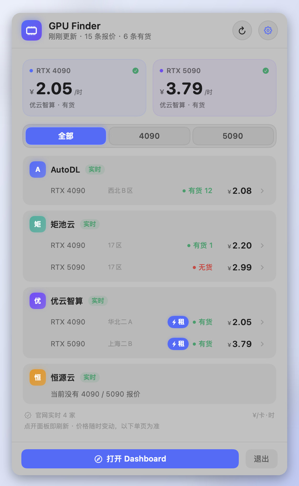
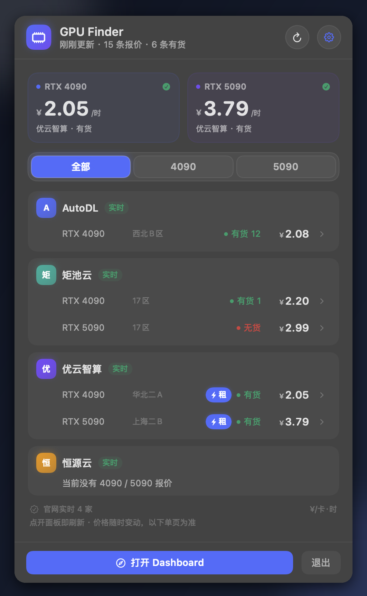
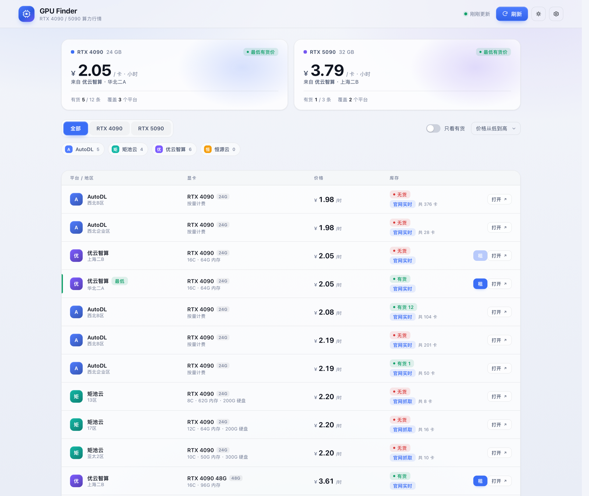
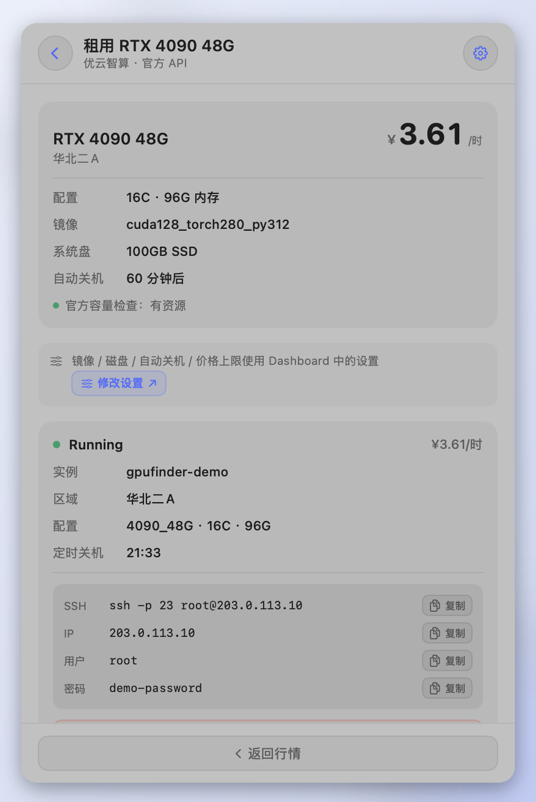
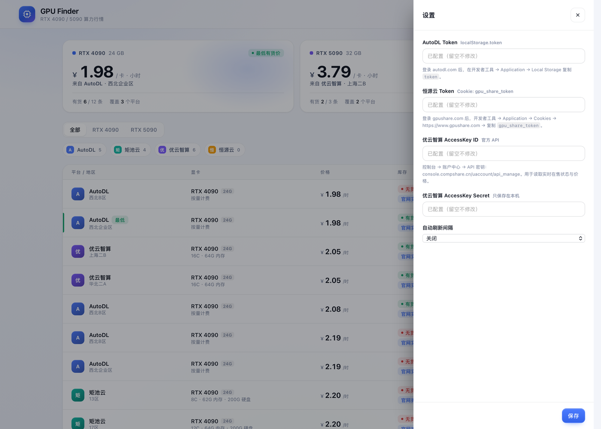

# GPU Finder

> 一个跑在 Mac 上的实时算力行情工具：**Python 后端 + 本地 Web Dashboard + CLI + 原生状态栏 App**，
> 汇总 **AutoDL、矩池云、优云智算、恒源云** 的 **RTX 4090 / 5090** 库存与价格，并支持部分平台一键租卡。

<p align="center">
  
  
</p>

<p align="center">
  
</p>


---

## 特性

- **四个平台，实时数据**：不使用第三方代采，不拿历史价格凑数；抓不到就明确显示「需登录 / 失败」。
- **官方接口优先**：
  - AutoDL：官方市场接口，精确到每台机器的**空闲卡数**；
  - 优云智算：官方 API，返回**在售 / 售罄**状态与实时价格；
  - 恒源云：官方市场接口，精确到**空闲 / 总卡数**；
  - 矩池云：官网算力市场公开数据（RSC 内嵌 JSON），实时**空闲 / 总卡数**。
- **三个入口**：本地 Web Dashboard、CLI、macOS 状态栏 App（点开即刷新）。
- **一键租卡**：点「租」→ 官方库存校验 → 二次确认 → 创建 → 拿到 SSH 命令与密码 → 一键释放。
  当前支持 **优云智算**、**AutoDL**、**恒源云**、**矩池云**（实验性）。
- **零第三方 Python 依赖**：只用标准库；App 使用 SwiftUI / AppKit 原生编译。
- **凭据只存本机**：`~/.config/gpufinder/config.json`，权限 `0600`，仓库中不包含任何密钥。

---

## 截图

| 状态栏面板 | 一键租卡 |
| --- | --- |
|  |  |

| Dashboard | 设置 |
| --- | --- |
|  |  |

更多截图见 [`docs/`](docs/) 与 [`screenshots/`](screenshots/)。

---

## 实时数据来源

| 平台 | 接口 / 页面 | 实时内容 |
| --- | --- | --- |
| **AutoDL** | `POST api.autodl.com/api/v1/machine/search`（需 token） | 每台机器空闲卡数、总卡数、按量价格 |
| **矩池云** | `matpool.com/host-market` 内嵌数据（游客可见） | 各资源池空闲 / 总卡数、按小时价格 |
| **优云智算** | `DescribeAvailableCompShareInstanceTypes` + `GetCompShareInstancePrice`（官方 API） | 在售 / 售罄状态、按量与抢占价格 |
| **恒源云** | `GET api.gpushare.com/app/api/market/machine/list`（需 token） | 空闲 / 总卡数、按小时价格 |

> **关于「钜池云」**：该平台官网正式名称为 **矩池云**（matpool.com），本项目使用其正式名称。

> **实时为空 ≠ 抓取失败**：如果平台当前确实没有 4090/5090 在售，会保持「实时」状态并提示
> 「当前没有 RTX 4090 / 5090 在售」，而不是拿旧价格凑数。

### 凭据

| 平台 | 凭据 | 获取位置 |
| --- | --- | --- |
| AutoDL | `token` | 登录后浏览器 Local Storage 的 `token`；或 `gpufinder login autodl` 用手机号 + 密码换取（不保存密码） |
| 恒源云 | `token` | 登录 gpushare.com 后浏览器 Cookie 的 `gpu_share_token` |
| 优云智算 | `AccessKey ID` + `AccessKey Secret` | 控制台 → 账户中心 → API 密钥 |
| 矩池云 | JWT + 用户 ID | Network 请求头的 `authorization`（Bearer 后的 JWT）与 `x-matpool-user-id` |

**Dashboard 填写（推荐）**：菜单栏图标 → 齿轮 → 设置抽屉 → 粘贴 → 保存。

**CLI 填写**：

```bash
./gpufinder.sh config --token autodl <TOKEN>
./gpufinder.sh config --token gpushare <GPU_SHARE_TOKEN>
./gpufinder.sh config --apikey compshare <ACCESS_KEY_ID> <ACCESS_KEY_SECRET>
```

环境变量也可：`GPUFINDER_AUTODL_TOKEN`、`GPUFINDER_GPUSHARE_TOKEN`、
`GPUFINDER_COMPSHARE_PUBLIC_KEY`、`GPUFINDER_COMPSHARE_PRIVATE_KEY`。

---

## 快速开始

### 1. 运行 Web Dashboard

```bash
git clone <repo-url>
cd GPU-Finder

python3 -m gpufinder serve --open
```

默认地址 `http://127.0.0.1:8765`；端口被占用时会自动换端口并在终端打印地址。

### 2. 安装 / 构建状态栏 App

需要 macOS 13+ 与 Xcode Command Line Tools：

```bash
xcode-select --install   # 如果还没装
./macos/build.sh         # 产物在 dist/GPU Finder.app
./macos/build.sh --install
open "/Applications/GPU Finder.app"
```

App 使用 `LSUIElement` 隐藏 Dock 图标，只常驻菜单栏；点击图标打开面板时立即刷新。

### 3. CLI

```bash
./gpufinder.sh list                 # 全部平台
./gpufinder.sh list --gpu 4090 -a   # 只看 4090 且有货
./gpufinder.sh refresh              # 强制刷新
./gpufinder.sh doctor               # 环境 + 连通性自检
./gpufinder.sh export --format csv -o gpu.csv
```

安装成全局命令：

```bash
python3 -m pip install -e .
gpufinder --help
```

---

## 一键租卡

Dashboard 右上角齿轮 →「一键租卡」：启用开关、默认镜像、系统盘、自动关机分钟数、价格上限。
然后在行情列表点对应平台报价右侧的「租」。

| 平台 | 租卡 | 说明 |
| --- | --- | --- |
| 优云智算 | ✅ | 官方容量校验、创建、SSH、关机/释放 |
| AutoDL | ✅ | 自动选主机、按机器 CUDA 上限选镜像、定时关机、关机后释放 |
| 恒源云 | ✅ | 自动选兼容镜像、创建、SSH、关机/释放 |
| 矩池云 | ✅（实验性） | 行情、创建、SSH、释放；需要 JWT + 用户 ID |

**安全边界**：

- 必须先在设置里启用，并且每次创建都要勾选确认；
- 按量计费，价格超过设置上限会拒绝创建；
- 默认定时关机，也可以随时手动释放；
- 本地只保存实例 ID 等元数据，**不把 SSH 密码写入磁盘**（需要时通过平台接口重新获取）。

> 租卡接口来自各平台网页登录态，可能随平台改版失效；行情查询不受影响。

---

## CLI 命令

```text
gpufinder list       [--gpu 4090|5090|all] [--platform autodl,matpool,...]
                     [--available] [--refresh] [--json]
gpufinder refresh    [--json]
gpufinder serve      [--port 8765] [--open] [--no-scheduler]
gpufinder providers            # 平台适配器与凭据状态
gpufinder doctor               # 环境、配置、连通性自检
gpufinder config     [--show] [--set port=8800]
                     [--token autodl|gpushare <token>]
                     [--apikey compshare <id> <secret>]
gpufinder login      autodl
gpufinder export     [--format json|csv|md] [-o file] [--gpu 4090]
```

示例输出：

```text
  平台      显卡          地区        价格/时  库存     来源
  ────────  ────────────  ──────────  ───────  ───────  ──────────
  AutoDL    RTX 4090      西北企业区  ¥1.98    有货 1   官网实时
  AutoDL    RTX 4090      西北B区     ¥2.08    有货 12  官网实时
  优云智算  RTX 4090      华北二A     ¥2.05    有货     官网实时
  恒源云    RTX 4090 48G  华东        ¥2.99    有货 1   官网实时
  矩池云    RTX 4090      13区        ¥2.20    无货     官网抓取
```

---

## HTTP API

后端只监听 `127.0.0.1`，供 Dashboard 与状态栏 App 共用：

| 方法 | 路径 | 说明 |
| --- | --- | --- |
| GET | `/api/health` | 健康检查、是否正在刷新 |
| GET | `/api/snapshot?refresh=1` | 当前行情快照（`refresh=1` 同步刷新） |
| POST | `/api/refresh` | 同步刷新全部平台 |
| POST | `/api/refresh/async` | 后台刷新（立即返回 202） |
| GET | `/api/providers` | 平台列表与凭据状态 |
| GET/POST | `/api/config` | 读取/保存设置与凭据 |
| POST | `/api/login/autodl` | 手机号 + 密码换取 token |
| GET | `/api/export?format=csv` | 导出 CSV |
| GET | `/api/rent/options` | 优云智算租卡选项 |
| POST | `/api/rent/quote` | 优云智算容量校验 + 报价（不扣费） |
| POST | `/api/rent/create` | 优云智算创建实例（需 `confirm=RENT`） |
| GET | `/api/rent/instances` | 优云智算实例状态 / SSH |
| POST | `/api/rent/stop` · `/api/rent/terminate` | 优云智算关机 / 释放 |
| POST | `/api/rent/autodl/quote` | AutoDL 选主机 + 实时价（不扣费） |
| POST | `/api/rent/autodl/create` | AutoDL 创建实例（需 `confirm=RENT`） |
| GET | `/api/rent/autodl/instances` | AutoDL 实例状态 / SSH |
| POST | `/api/rent/autodl/terminate` | AutoDL 关机并释放 |
| POST | `/api/rent/gpushare/quote` | 恒源云选机器 + 实时价（不扣费） |
| POST | `/api/rent/gpushare/create` | 恒源云创建实例（需 `confirm=RENT`） |
| GET | `/api/rent/gpushare/instances` | 恒源云实例状态 / SSH |
| POST | `/api/rent/gpushare/terminate` | 恒源云关机并释放 |
| POST | `/api/rent/matpool/quote` | 矩池云选资源池 + 实时价（不扣费） |
| POST | `/api/rent/matpool/create` | 矩池云创建实例（需 `confirm=RENT`） |
| GET | `/api/rent/matpool/instances` | 矩池云实例状态 / SSH |
| POST | `/api/rent/matpool/terminate` | 矩池云释放实例 |
| GET | `/` | Dashboard |

快照 JSON（`schema: 1`）：

```json
{
  "generated_at": "2026-01-01T12:00:00+08:00",
  "summary": { "offers": 11, "available": 4, "by_family": { "rtx4090": { "min_price": 1.88 } } },
  "platforms": [{ "id": "compshare", "name": "优云智算", "mode": "live", "ok": true }],
  "offers": [{
    "platform": "autodl", "gpu": "RTX 4090", "family": "rtx4090",
    "region": "西北B区", "price": 1.98, "available": true, "stock": 50,
    "source": "api", "source_label": "官网市场接口（登录态）"
  }]
}
```

---

## 项目结构

```text
GPU-Finder/
├── gpufinder/
│   ├── cli.py                 # 命令行
│   ├── server.py              # 本地 HTTP 服务 + 静态资源
│   ├── service.py             # 并发刷新、快照、磁盘缓存
│   ├── models.py              # Offer / Snapshot schema
│   ├── gpu.py                 # 型号归一化（4090D、48G 等变体）
│   ├── config.py              # 配置与凭据（0600）
│   ├── http.py                # 标准库 HTTP 客户端
│   ├── rent.py                # 优云智算租卡
│   ├── rent_autodl.py         # AutoDL 租卡
│   ├── rent_gpushare.py       # 恒源云租卡
│   ├── rent_matpool.py        # 矩池云租卡
│   ├── providers/
│   │   ├── autodl.py          # AutoDL 市场接口 + 手机号登录
│   │   ├── matpool.py         # 矩池云官网 RSC 解析
│   │   ├── compshare.py       # 优云智算官方 API（UCloud 签名）
│   │   └── gpushare.py        # 恒源云市场接口
│   └── web/                   # 无依赖 Dashboard
├── macos/                     # SwiftUI 状态栏 App
├── tests/                     # 离线解析测试
├── scripts/                   # 图标、截图、页面探测
├── docs/                      # 文档与截图
├── .github/                   # CI / Issue 模板
├── config.example.json        # 配置示例（不含任何密钥）
├── Makefile
└── pyproject.toml
```

**刷新机制**：点击菜单栏图标 → `NSPopover` 显示 → 立即刷新；面板先展示上次结果，
刷新完成后自动更新；菜单栏图标旁显示当前最低有货价。

---

## 测试与开发

```bash
make test
# 或
python3 -m unittest discover -s tests -v
python3 -m compileall -q gpufinder
```

覆盖：型号归一化、矩池云 RSC 解析、UCloud 签名（官方示例校验）、AutoDL / 恒源云接口字段、
快照 summary、HTTP API 与静态资源。

开发文档：

- [配置说明](docs/CONFIGURATION.md)
- [平台适配说明](docs/PROVIDERS.md)
- [一键租卡说明](docs/RENT.md)
- [开发与构建](docs/DEVELOPMENT.md)

---

## 后续计划

- 未来会增加更多平台并扩充显卡型号。

---

## 已知限制

- **凭据有效期**：AutoDL 网页 token 约 2 个月；恒源云 `gpu_share_token` 约 1 天；优云智算 API 密钥长期有效。
  过期后界面显示「需登录」，重新获取即可。
- **优云智算库存粒度**：官方 API 返回「在售 / 售罄」，不返回具体空闲卡数。
- **矩池云行情**：依赖官网页面结构，改版可能导致解析失败；单个平台失败不影响其它平台。
- **矩池云租卡（实验性）**：需要 JWT + `x-matpool-user-id`；平台改版或库存变化可能导致失败。
- **余额要求**：优云智算 / AutoDL / 恒源云 / 矩池云创建实例需要账户有可用余额。
- 价格均折算为 **元/卡/小时**；包日 / 包月 / 抢占价的换算在备注中说明，**最终以下单页为准**。
- **库存是快照，不是预留**：接口空闲数可能被其他用户抢走；账号实例配额、余额、镜像/磁盘配置、
  单次租用卡数都可能让「有货」最终下单失败。

---

## 免责声明

- 本工具只读取各平台**官方 API 或公网页面**，不绕过验证码、不破解、不代替下单。
- 价格与库存随时变动，请以平台下单页为准。
- 平台名称与商标归各自公司所有。

## License

[MIT](LICENSE)
