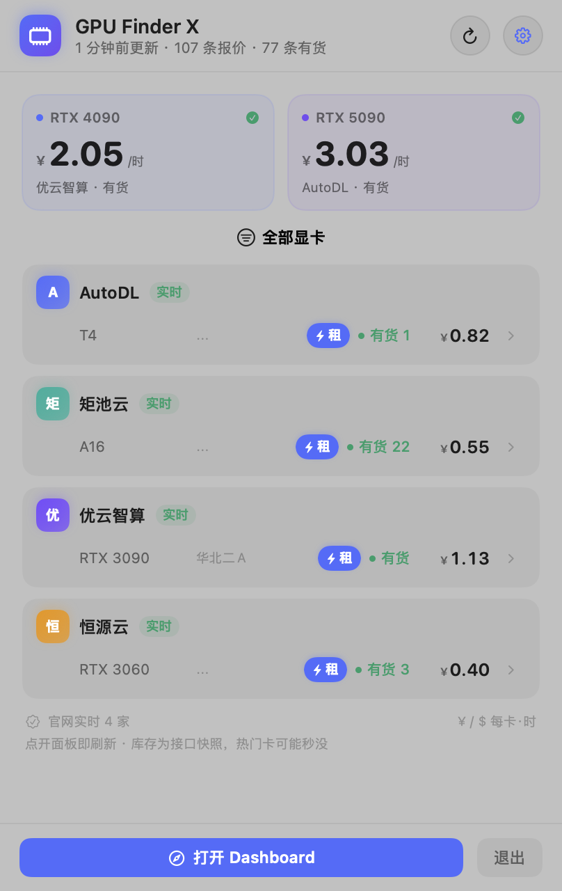
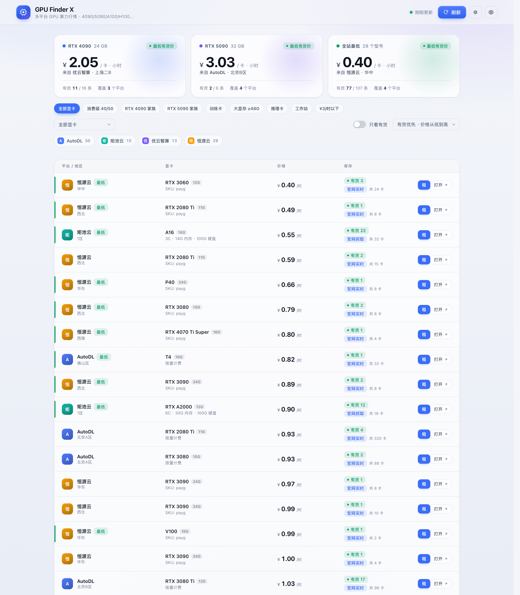

# GPU Finder X

> 一个跑在 Mac 上的多平台 GPU 行情工具：**Python 后端 + 本地 Web Dashboard + CLI + 原生状态栏 App**。
> 实时汇总 **AutoDL、矩池云、优云智算、恒源云** 的 **40+ 款常用 GPU** 库存与价格，
> 并支持国内平台一键租卡。

<p align="center">
  
  
</p>


---

## 特性

- **四个国内平台，实时数据**：AutoDL、矩池云、优云智算、恒源云。
- **40+ 款 GPU**：RTX 20/30/40/50 系、A100/A800/H100/H800/H200/H20、L40S/L4、A6000/A5000/A4000、
  V100/T4/P100、B200/B300、MI300X 等；新增型号只需改 `gpu_catalog.py`。
- **常用配置预设**：全部显卡、消费级 40/50、4090 家族、5090 家族、训练卡、大显存 ≥48G、
  推理卡、工作站、¥3/时以下，一键筛选。
- **三个入口**：本地 Web Dashboard、CLI、macOS 状态栏 App（点开即刷新）。
- **概览可自选**：Dashboard 显示 3 张、状态栏显示前 2 张；在设置里选择任意显卡家族，不再固定 4090/5090。
- **一键租卡**：优云智算、AutoDL、恒源云、矩池云（实验性），创建后直接拿 SSH / 密码，可一键释放。
- **零第三方 Python 依赖**：只用标准库；App 用 SwiftUI / AppKit 原生编译。
- **凭据只存本机**：`~/.config/gpufinder/config.json`，权限 `0600`，仓库中不包含任何密钥。

---

## 显卡覆盖

| 分类 | 已覆盖型号（部分） |
| --- | --- |
| 消费级 | RTX 5090 / 5090D / 5080 / 5070 Ti / 5070 / 5060 Ti / 5060；4090 / 4090D / 4090 48G / 4080 Super / 4070 Ti Super / 4070 / 4060 Ti；3090 / 3080 / 3070 / 3060；2080 Ti / 2070 / 2060 |
| 工作站 | RTX PRO 6000、RTX 6000 Ada、RTX 5000/4500/4000 Ada、A6000 / A5000 / A4000 / A2000、RTX 8000/6000/5000 |
| 数据中心 | B300 / B200、H200 / H100 / H800 / H20、A100 40G/80G、A800、L40S / L40 / L4、A40 / A30 / A10 / A16、V100 16G/32G、T4 / P100 / P40、MI300X |

平台不一定同时提供全部型号；行情页只显示平台实际返回的型号。
4090 / 4090D / 4090 48G、5090 / 5090D 作为独立型号列出；「4090 家族 / 5090 家族」预设会包含对应变体。

## 常用预设

| 预设 | 筛选条件 |
| --- | --- |
| 全部显卡 | 不筛选 |
| 消费级 40/50 | 消费级分类 |
| RTX 4090 家族 | 4090 / 4090D / 4090 48G |
| RTX 5090 家族 | 5090 / 5090D |
| 训练卡 | A100 / A800 / H100 / H800 / H200 / H20 |
| 大显存 ≥48G | 显存 48GB 以上 |
| 推理卡 | L4 / L40S / 4090 / 5090 |
| 工作站 | A6000 / A5000 / RTX 6000 Ada 等 |
| ¥3/时以下 | 人民币报价 ≤ ¥3/时 |

预设定义在 `gpufinder/presets.py`，Dashboard、CLI 共用。

---

## 数据来源

| 平台 | 接口 / 页面 | 币种 | 实时内容 |
| --- | --- | --- | --- |
| **AutoDL** | `POST api.autodl.com/api/v1/machine/search`（需 token） | CNY | 每台机器空闲卡数、总卡数、按量价格 |
| **矩池云** | `matpool.com/host-market` 内嵌数据 | CNY | 各资源池空闲 / 总卡数、价格 |
| **优云智算** | `DescribeAvailableCompShareInstanceTypes` + 价格 API | CNY | 在售 / 售罄、按量与抢占价格 |
| **恒源云** | `GET api.gpushare.com/app/api/market/machine/list`（需 token） | CNY | 空闲 / 总卡数、价格 |

> **实时为空 ≠ 抓取失败**：平台当前没有某型号时保持「实时」状态并显示空结果，不拿旧价格凑数。

### 凭据

| 平台 | 凭据 | 获取位置 |
| --- | --- | --- |
| AutoDL | `token` | 登录后 Local Storage 的 `token`；或 `gpufinder login autodl` |
| 恒源云 | `token` | Cookie `gpu_share_token` |
| 优云智算 | AccessKey ID + Secret | 控制台 → 账户中心 → API 密钥 |
| 矩池云 | JWT + 用户 ID | 请求头 `authorization` 与 `x-matpool-user-id` |

**Dashboard 填写（推荐）**：菜单栏图标 → 齿轮 → 设置抽屉 → 粘贴 → 保存。

**CLI 填写**：

```bash
./gpufinder.sh config --token autodl <TOKEN>
./gpufinder.sh config --token gpushare <TOKEN>
./gpufinder.sh config --apikey compshare <ACCESS_KEY_ID> <ACCESS_KEY_SECRET>
```

环境变量：`GPUFINDER_AUTODL_TOKEN`、`GPUFINDER_GPUSHARE_TOKEN`、
`GPUFINDER_COMPSHARE_PUBLIC_KEY`、`GPUFINDER_COMPSHARE_PRIVATE_KEY`、
`GPUFINDER_MATPOOL_TOKEN`、`GPUFINDER_MATPOOL_USER_ID`。

---

## 快速开始

```bash
git clone <repo-url>
cd GPU-Finder-X

python3 -m gpufinder serve --open     # Dashboard: http://127.0.0.1:8765
./macos/build.sh --install            # 构建并安装状态栏 App
open "/Applications/GPU Finder X.app"
```

CLI：

```bash
./gpufinder.sh list                          # 全部
./gpufinder.sh list --gpu 4090 -a            # 4090 有货
./gpufinder.sh list --gpu a100,h100 -a       # 数据中心卡
./gpufinder.sh list --preset training -a     # 训练卡预设
./gpufinder.sh list --preset budget          # ¥3/时以下
./gpufinder.sh export --format csv -o gpu.csv
```

安装成全局命令：`python3 -m pip install -e .`。

---

## 一键租卡

设置抽屉里的「首页概览」可以选择最多 3 个显卡家族，Dashboard 用 3 张、状态栏面板用前 2 张；留空时按当前有货数量自动挑。

租卡配置是跨平台的：

- **账户余额**：设置里分四行显示优云智算 / AutoDL / 恒源云 / 矩池云余额，来自各平台官方接口；
- **启用开关 / 价格上限**：所有平台生效；
- **优云智算镜像 / 系统盘 / 自动关机**：只对优云智算生效；
- **AutoDL 镜像**：可选；留空会按机器 CUDA 上限自动选择；
- **恒源云**：镜像可选（按机器 CUDA 兼容），自动关机单独设置；系统盘由平台决定；
- **矩池云**：镜像偏好可选（自动 / 最新），系统盘由资源池决定，暂不支持定时关机。

| 平台 | 行情 | 租卡 | 说明 |
| --- | --- | --- | --- |
| 优云智算 | ✅ | ✅ | 官方 API，容量校验 / 创建 / SSH / 释放 |
| AutoDL | ✅ | ✅ | 自动选机器，按机器 CUDA 上限选镜像，定时关机 |
| 恒源云 | ✅ | ✅ | 自动选兼容镜像，SSH / 关机 / 释放 |
| 矩池云 | ✅ | ✅（实验性） | JWT + 用户 ID，资源池创建 / 释放 |

安全边界：

- 必须在设置里启用「一键租卡」；
- 每次创建都要勾选确认；
- 价格超过 `max_hourly_price` 拒绝创建；
- 默认定时关机，也可以随时手动释放；
- SSH 密码只从平台接口临时获取，不写入磁盘。

---

## HTTP API

后端只监听 `127.0.0.1`：

| 方法 | 路径 | 说明 |
| --- | --- | --- |
| GET | `/api/health` | 健康检查 |
| GET | `/api/snapshot?refresh=1` | 行情快照 |
| POST | `/api/refresh` | 同步刷新 |
| GET | `/api/catalog` | 显卡目录 + 预设 |
| GET | `/api/presets` | 常用预设 |
| GET | `/api/providers` | 平台状态 |
| GET/POST | `/api/config` | 设置与凭据 |
| POST | `/api/login/autodl` | 手机号 + 密码换 token |
| GET | `/api/export?format=csv` | 导出 |
| GET | `/api/rent/balances` | 四个平台账户余额（并行读取） |
| GET | `/api/rent/options` | 优云智算租卡选项 |
| POST | `/api/rent/quote` | 优云智算报价 |
| POST | `/api/rent/create` | 优云智算创建 |
| GET | `/api/rent/instances` | 优云智算实例 |
| POST | `/api/rent/stop` · `/api/rent/terminate` | 优云智算关机 / 释放 |
| POST | `/api/rent/autodl/quote` · `create` · `terminate` | AutoDL 租卡 |
| GET | `/api/rent/autodl/instances` | AutoDL 实例 |
| POST | `/api/rent/gpushare/quote` · `create` · `terminate` | 恒源云租卡 |
| GET | `/api/rent/gpushare/instances` | 恒源云实例 |
| POST | `/api/rent/matpool/quote` · `create` · `terminate` | 矩池云租卡 |
| GET | `/api/rent/matpool/instances` | 矩池云实例 |

---

## 项目结构

```text
GPU-Finder-X/
├── gpufinder/
│   ├── gpu_catalog.py      # 40+ GPU 型号目录（新增型号只改这里）
│   ├── presets.py          # 常用显卡 / 配置预设
│   ├── providers/
│   │   ├── autodl.py       # AutoDL
│   │   ├── matpool.py      # 矩池云
│   │   ├── compshare.py    # 优云智算
│   │   └── gpushare.py     # 恒源云
│   ├── rent*.py            # 各平台租卡
│   ├── server.py           # 本地 API + 静态资源
│   └── web/                # 无构建 Dashboard
├── macos/                  # SwiftUI 状态栏 App
├── tests/                  # 离线测试
├── docs/                   # 文档与截图
└── .github/workflows/ci.yml
```

---

## 测试与开发

```bash
make test
python3 -m unittest discover -s tests -v
python3 scripts/check_no_secrets.py
```

开发文档：

- [配置说明](docs/CONFIGURATION.md)
- [平台适配](docs/PROVIDERS.md)
- [一键租卡](docs/RENT.md)
- [开发与构建](docs/DEVELOPMENT.md)

---

## 已知限制

- **矩池云租卡**：需要 JWT + `x-matpool-user-id`，平台改版可能失效。
- **平台接口**：多为登录态/非公开 API，改版可能导致单平台失败，不影响其它平台。
- **库存是快照**：接口空闲数可能被其他用户抢走；配额、余额、镜像/磁盘也会影响最终下单。
- 价格与库存随时变动，请以平台下单页为准。

## License

[MIT](LICENSE)
